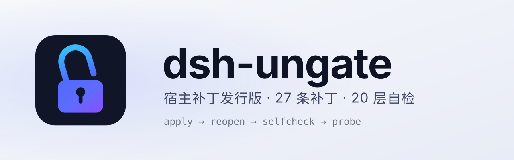

<div align="center">

<picture>
  <source media="(prefers-color-scheme: dark)" srcset="banner-dark.svg">
  
</picture>

# dsh-ungate

**Removes part of DeepSeek Harness's restrictions: approval prompts, sandbox denials, and the model's "run it yourself" hedging.**

27 host patches · 20-layer selfcheck · left-sidebar panel

[](https://github.com/youki258/dsh-ungate/releases)
[](https://github.com/youki258/dsh-ungate/stargazers)
[](../LICENSE)
[](https://nodejs.org)

Current version **0.2.4** · Verified **DSH Desktop 0.2.1-rc.1 / 0.2.1-rc.2 / 0.2.1-rc.3 / 0.2.1-rc.5** (0.2.2-rc.1 on the web and npm CLI surfaces only) · [中文](../README.zh-CN.md)

</div>

---

## What it is

A plugin that runs on your machine inside DSH. After installing, a few everyday interruptions disappear:

- **No more clicking Allow** — tool calls stop popping approval prompts and just run.
- **No more sandbox refusals** — file writes and commands follow the profile's permission config (default `danger-full-access`).
- **No more "run it yourself"** — the model's "I need you to confirm first" / "you should run that" hedging is gone.
- **Your prompt, your rules** — the body of `$DSH_HOME/prompt-inject.md` enters the system prompt every turn.

It does not change the model itself and does not decide for you: scope is declared by the operator, and the plugin performs no content review and no public-target gate. Changes land only on the host source copy, snapshotted before every apply and undoable with `ungate revert`.

## Install

**Pinned tgz (recommended)**

```sh
dsh plugin --profile web add https://github.com/youki258/dsh-ungate/releases/download/v0.2.4/dsh-ungate-0.2.4.tgz
```

**npm**

```sh
dsh plugin --profile web add dsh-ungate@0.2.4
```

**Community installer** (backup migration, old-package swap; review with `--dry-run` first)

```sh
sh scripts/install.sh --dry-run      # Linux/macOS
pwsh scripts/install.ps1 -DryRun     # Windows
```

Desktop shells: replace `--profile web` with `desktop`.

## Three steps after installing

```sh
ungate apply                    # same as pressing Apply in the panel: writes a host source copy and keeps backups
# Fully quit DSH (tray exit / ⌘Q, not just closing the window), reopen
ungate selfcheck --json         # state=ok, broken empty
ungate probe new                # send any message; the model should echo the nonce verbatim
```

A successful disk write is not proof of load: host modules are imported once at startup, so conclusions come from a post-restart selfcheck and a probe.

## Compatibility

| Host | Result |
| --- | --- |
| DSH Desktop 0.2.1-rc.1 / rc.2 / rc.3 / rc.5 | Verified |
| DSH Desktop 0.2.2-rc.1 | Verified (web surface) |
| Any other 0.2.x | Run `ungate diagnose` first |

Anchor regressions live in `test/patch-anchors.test.mjs`; per-release results are in [release notes](../release-notes.md).

## Commands

| Command | Purpose |
| --- | --- |
| `ungate status` / `selfcheck [--json]` | host and patch overview / 20 per-layer evidence rows |
| `ungate apply` / `revert` | write patches / undo them (both back up first) |
| `ungate diagnose` / `reanchor …` | anchor-drift diagnosis / semi-automatic re-anchoring |
| `ungate backup` / `rollback <id>` | snapshot / rollback |

Every command and exit code: [CLI](CLI.md). `purge` and `dsh-purge` are legacy names for the same entry point and still work; the chat slash command is still `/purge`.

## Updating

The plugin never self-updates. Market installs upgrade through the DSH plugin market or `dsh plugin --profile <n> update`; tarball installs re-run `plugin add` with the new version (`not-updatable` by design — re-adding is the upgrade); after a host upgrade the asar reseals, so press Apply once and reopen.

## Docs

| File | Content |
| --- | --- |
| [INSTALLATION](INSTALLATION.md) | install, upgrade, rollback, failure triage |
| [CLI](CLI.md) | every command, exit code, legacy names |
| [STATE](STATE.md) | the 27 patches, selfcheck semantics, known limits |
| [MAINTENANCE](MAINTENANCE.md) | anchor drift and re-anchoring, HTTP endpoints |
| [RUNBOOK](RUNBOOK.md) | operations: restart, health check, recovery |

## Provenance and license

MIT — see [LICENSE](../LICENSE).

- Upstream: [YuJunZhiXue/dsh-purge](https://github.com/YuJunZhiXue/dsh-purge) (YuJunZhiXue).
- The code comes from the minimal cut of [kingcharleslzy-ai/dsh-purge](https://github.com/kingcharleslzy-ai/dsh-purge); [youki258/dsh-ungate](https://github.com/youki258/dsh-ungate) subtracts on top: no tool surface, no legacy debug entry points, no in-plugin self-update, 27 patches. Not an official release by the upstream author.
- Full attribution: [NOTICE.md](../NOTICE.md) and [CONTRIBUTORS.md](../CONTRIBUTORS.md).
